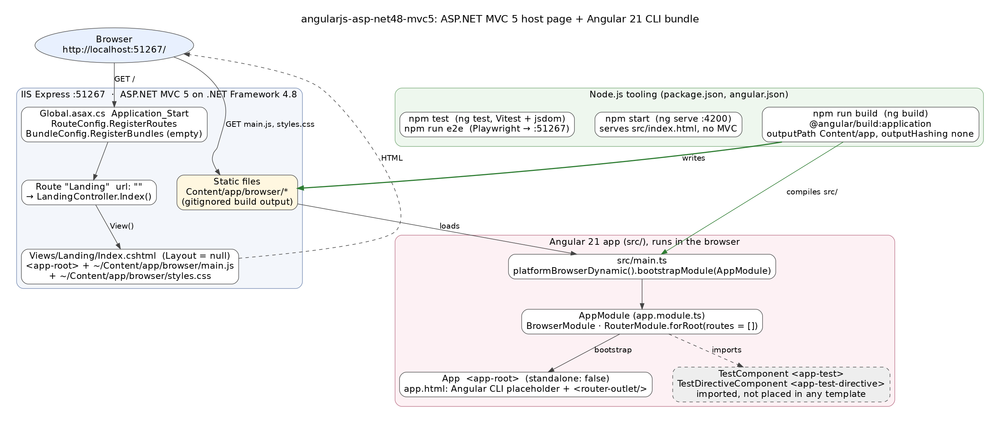

# Angular with .NET Framework
A demo project that serves an Angular 21 app from an ASP.NET MVC 5 site on .NET Framework 4.8. It started as an AngularJS + jQuery app; the AngularJS code and ASP.NET script bundling have been replaced by an Angular CLI build.

See [docs/ARCHITECTURE.md](docs/ARCHITECTURE.md) for how the pieces fit together, with a [diagram](docs/diagrams/architecture.png) ([Graphviz source](docs/diagrams/architecture.dot)).

## Features

- Angular 21 (Angular CLI workspace in `src/`, NgModule bootstrap via `AppModule`)
- .NET Framework 4.8
- ASP.NET MVC 5 host page (`Views/Landing/Index.cshtml`) that loads the Angular CLI build output from `Content/app/browser/`
- Unit tests with `ng test` (Vitest) and end-to-end tests with Playwright

## Project layout

| Path | Contents |
|------|----------|
| `src/` | Angular app: `main.ts`, `app/` (`AppModule`, `App`), `app/components/` |
| `angular.json` | Angular CLI config; builds to `Content/app/` |
| `Content/app/browser/` | `ng build` output served by the MVC site (git-ignored) |
| `App_Start/`, `Controllers/`, `Views/`, `Global.asax` | ASP.NET MVC 5 startup, root route, `LandingController` and the host view |
| `e2e/` | Playwright tests and page objects |
| `docs/` | Architecture doc and diagram |
| `MIGRATION_AUDIT.md` | Historical inventory of the AngularJS code before the migration |

## Prerequisites

- Windows 10/11 - Older versions of Windows may work but have not been tested.
- [Visual Studio 2022](https://visualstudio.microsoft.com/downloads/) - The free *Community Edition* is sufficient.
Older versions of Visual Studio may work but have not been tested.
- [.Net Framework 4.8](https://dotnet.microsoft.com/en-us/download/dotnet-framework) - This can optionally be installed
as part of the Visual Studio 2022 installation as well.
- [Node.js](https://nodejs.org/) 20.19+ or 22.12+ (required by Angular 21) and npm.

## Getting Started
- Clone repository: `git clone https://github.com/COG-GTM/angularjs-asp-net48-mvc5.git`.
- Switch to the project's directory: `cd angularjs-asp-net48-mvc5`.
- Install npm packages: `npm install`.
- Build the Angular app into `Content/app/browser/`: `npm run build` (or `npm run watch` to rebuild on change).
- Open the project in Visual Studio. NuGet packages are restored from `packages.config` on first build.
- Run the project by pressing the `F5` key or using the green start button in the toolbar. IIS Express serves the site
  at `http://localhost:51267/` and opens it in your browser.

## Scripts

| Command | What it does |
|---------|--------------|
| `npm run build` | Production build to `Content/app/browser/` |
| `npm run watch` | Development build in watch mode |
| `npm start` | Angular dev server on `http://localhost:4200/` (Angular only, without the MVC host page) |
| `npm test` | Unit tests (`ng test`) |
| `npm run e2e` | Playwright tests against the running site on `http://localhost:51267/` |
