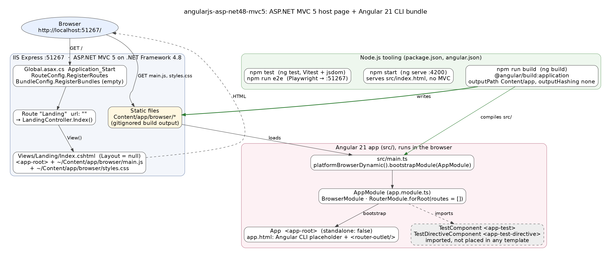

# Architecture

This page describes what the code on `main` does today: an ASP.NET MVC 5 site on .NET Framework 4.8 that serves one Razor page, and an Angular 21 app (built with the Angular CLI) that the page loads. The AngularJS, jQuery and `System.Web.Optimization` bundles from the original 2023 project were removed in PRs #56–#61.



The diagram source is [`diagrams/architecture.dot`](diagrams/architecture.dot) (Graphviz). After editing it, run `docs/diagrams/render.sh` to regenerate [`architecture.png`](diagrams/architecture.png) and [`architecture.svg`](diagrams/architecture.svg).

## Request flow

1. **Startup.** `Global.asax.cs` (`MvcApplication.Application_Start`) registers areas, calls `RouteConfig.RegisterRoutes`, and calls `BundleConfig.RegisterBundles`. `BundleConfig` is now empty: no script or style bundles are registered.
2. **Routing.** `App_Start/RouteConfig.cs` maps one route, `Landing`, for the empty URL (`/`) to `LandingController.Index`.
3. **Host page.** `Controllers/LandingController.cs` returns `Views/Landing/Index.cshtml`. The view has `Layout = null` and contains only `<app-root></app-root>`, a link to `~/Content/app/browser/styles.css` and a script tag for `~/Content/app/browser/main.js` (plus the Roboto Google Font). The page title is still `XLTS for AngularJS with .NET Framework`.
4. **Static assets.** IIS (IIS Express on `http://localhost:51267/` in Visual Studio, from the `.csproj`) serves `Content/app/browser/*` as static files. These files are produced by `npm run build` and are git-ignored (`/Content/app/` in `.gitignore`), so they must be built before the site can render anything.
5. **Angular bootstrap.** `src/main.ts` calls `platformBrowserDynamic().bootstrapModule(AppModule)`.

## Angular app (`src/`)

| File | What it does |
|------|--------------|
| `src/main.ts` | Browser entry point; bootstraps `AppModule`. |
| `src/app/app.module.ts` | `AppModule` (NgModule). Declares `App`, imports `BrowserModule`, `RouterModule.forRoot(routes)`, and the standalone `TestComponent` and `TestDirectiveComponent`; bootstraps `App`. |
| `src/app/app.ts`, `app.html`, `app.css` | `App` component, selector `app-root`, `standalone: false`. Its template is the Angular CLI starter page ("Hello, angular-app") ending in `<router-outlet />`. |
| `src/app/app.routes.ts` | `routes: Routes = []` (no routes). |
| `src/app/components/test/test.component.ts` | Standalone `TestComponent` (`<app-test>`), shows `Angular Version: <VERSION.full>` with `data-testid="angular-version"`; migrated from the AngularJS `testComponent`. |
| `src/app/components/test-directive/test-directive.component.ts` | Standalone `TestDirectiveComponent` (`<app-test-directive>`), same output with `data-testid="angular-version-directive"`; migrated from the AngularJS `testDirective`. |
| `src/index.html`, `src/styles.css` | Document shell used only by `ng serve`, and global styles compiled into `styles.css`. |
| `public/` | Static assets copied into the build (`favicon.ico`). |

`TestComponent` and `TestDirectiveComponent` are imported into `AppModule` but no template uses `<app-test>` or `<app-test-directive>`, so the page served at `/` shows only the CLI starter content.

## Build and output

`angular.json` defines one project, `angular-app`:

- `ng build` uses `@angular/build:application` with `outputPath: Content/app`, so the browser files land in `Content/app/browser/` (`main.js`, `styles.css`, `index.html`, `favicon.ico`). The production configuration (the default) sets `outputHashing: none`, which keeps the file names that `Index.cshtml` hard-codes.
- `ng serve` (`npm start`) runs the Angular dev server on `http://localhost:4200/` with `src/index.html`; it does not run the MVC site.
- `ng test` (`npm test`) uses `@angular/build:unit-test` (Vitest with jsdom) for `src/**/*.spec.ts`.

The ASP.NET side is a classic `packages.config` web application project (`angularjs-asp-net48-mvc5.csproj`) referencing ASP.NET MVC 5.2.7, Razor 3, Web Pages, `Microsoft.AspNet.Web.Optimization` (still referenced, no bundles), WebGrease, Antlr and Newtonsoft.Json.

## Tests

- **Unit:** `src/app/app.spec.ts` checks that `App` is created and renders `Hello, angular-app`.
- **End-to-end:** Playwright (`playwright.config.js`, Chromium, headless) runs `e2e/tests/app.e2e.js` against `http://localhost:51267/`, which must already be running (there is no `webServer` block). Page objects are in `e2e/pages/`. The tests expect the title `XLTS for AngularJS with .NET Framework` on an element with `data-testid="title"` (`e2e/pages/index-page.js`) and the `Angular Version: 21.2.0` text from both test components.

## Repository layout

```
App_Start/          BundleConfig (empty), RouteConfig (root route)
Controllers/        LandingController
Views/              Landing/Index.cshtml host page, Views/web.config
src/                Angular 21 app (main.ts, app/, components/)
public/             static assets copied by ng build
Content/app/        ng build output (git-ignored)
e2e/                Playwright tests and page objects
docs/               this page and the architecture diagram
angular.json        Angular CLI workspace
Global.asax(.cs)    MVC application startup
Web.config          ASP.NET / .NET Framework 4.8 configuration
packages.config     NuGet packages for the MVC project
```

`MIGRATION_AUDIT.md` is the pre-migration inventory of the old AngularJS code (`WebApp/`, `ng-app`, bundles); none of the files it lists exist on `main` any more.
